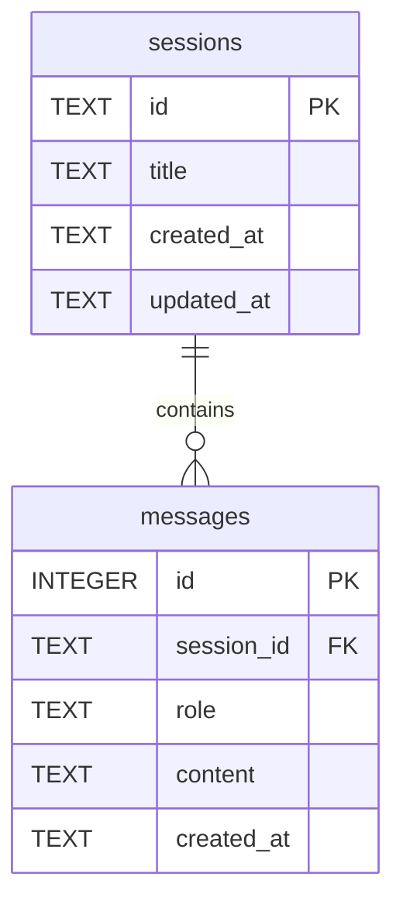

# 聊天机器人 + SQLite 持久化 + 前端页面

这是一个基于 Python + FastAPI 的聊天机器人，支持会话持久化到 SQLite，并提供一个纯 HTML 前端页面。

## 功能概览

- 会话信息和消息记录存放在 SQLite 数据库中
- 服务重启后历史会话仍然存在
- 提供 `/sessions`、`/chat`、`/chat/stream` 等接口
- 后端托管一个简单的聊天页面，可通过浏览器访问 `http://127.0.0.1:8000`
- 代码中保留自动建表逻辑，并通过 `.gitignore` 忽略数据库文件

## ORM 与数据库结构

本项目使用 SQLAlchemy 2.x 声明式模型：`store.SessionModel` 对应 `sessions` 表，`store.MessageModel` 对应 `messages` 表。`SessionModel.messages` 与 `MessageModel.session` 是双向 `relationship`；`messages.session_id` 为指向 `sessions.id` 的外键并配置级联删除。启动时执行 `Base.metadata.create_all()`，只建缺失表，不删除旧表或清空旧数据。

如果后续调整表结构，应先备份再升级：

```bash
cp chat.db chat.db.backup
```

升级时采用新增可空列、保留旧列、回填数据，再更新模型的方式；不要直接删除数据库。项目启动不会清空或覆盖已有会话和消息。

关键词查询使用 ORM 表达式：

```python
select(MessageModel).where(
    MessageModel.session_id == session_id,
    MessageModel.content.contains(keyword),
).order_by(MessageModel.id.asc())
```

对应 SQL 可概括为：

```sql
SELECT messages.id, messages.session_id, messages.role, messages.content, messages.created_at
FROM messages
WHERE messages.session_id = ?
  AND messages.content LIKE '%关键词%'
ORDER BY messages.id ASC;
```

两者表达相同查询语义：ORM 根据模型字段生成表名、列名和参数绑定，结果再映射为 `MessageModel` 对象。

## 数据库结构



## 快速开始

```bash
# 1) 安装依赖
pip install -r requirements.txt

# 2) 复制环境变量模板
cp .env.example .env
# 编辑 .env，填入你的 CHATBOT_API_KEY

# 3) 启动网页服务
python main.py
# 或者
uvicorn app:app --host 0.0.0.0 --port 8000
```

访问：

- 聊天页面：`http://127.0.0.1:8000`
- 健康检查：`http://127.0.0.1:8000/health`

## 接口说明

- `GET /sessions`：获取所有会话
- `POST /sessions`：创建会话
- `GET /sessions/{session_id}/messages`：获取某会话消息记录
- `POST /chat`：发送消息并返回回复
- `GET /chat/stream`：流式聊天接口
- `DELETE /sessions/{session_id}`：删除会话
- `POST /sessions/{session_id}/clear`：清空某会话

## 运行测试

```bash
pytest -q
```

## 项目结构

```text
├── app.py            # FastAPI 应用入口
├── main.py           # 直接启动脚本
├── chatbot.py        # 命令行聊天程序
├── llm.py            # OpenAI SDK 调用封装
├── store.py          # SQLite 会话存储层
├── index.html        # 纯 HTML 前端页面
├── config.py         # 配置加载
├── requirements.txt
├── README.md
├── .env.example
├── .gitignore
├── tests/
│   ├── test_config.py
│   ├── test_llm.py
│   ├── test_db.py
│   └── test_api.py
└── chat.db           # 本地数据库文件，已在 .gitignore 中忽略
```
